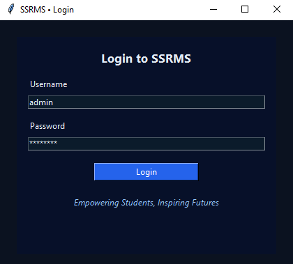
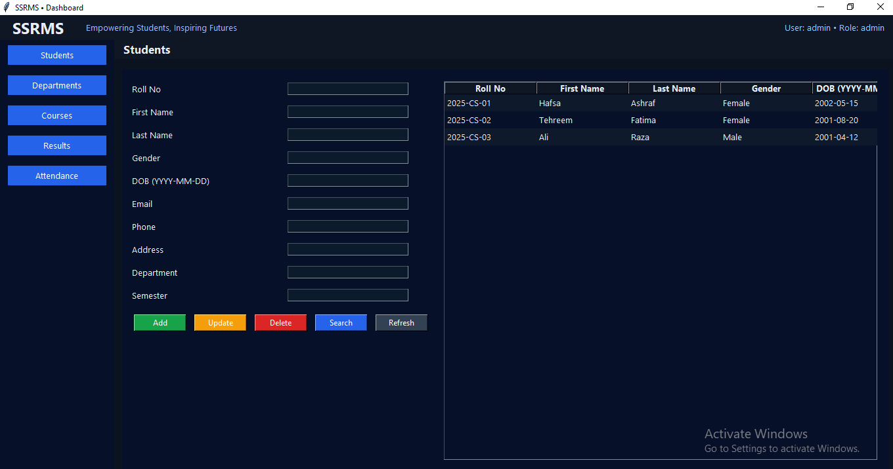
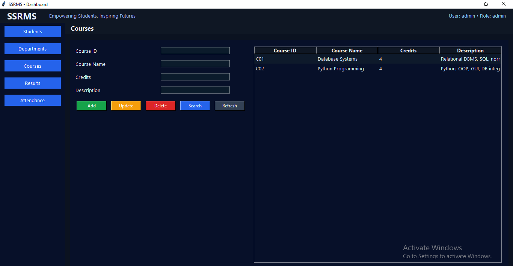
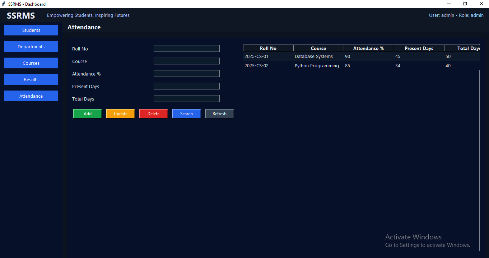
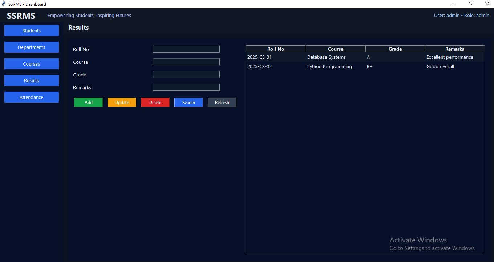

# 🎓 Smart Student Record Management System (SSRMS)

A desktop application developed using **Python, Tkinter, Oracle Database, and SQL** for managing academic records efficiently. SSRMS helps organize student, course, department, attendance, and result information in one place using a structured Oracle database backend.

---

## ✨ Features

- 👨‍🎓 Student Management
- 📚 Course Management
- 🏫 Department Management
- 📅 Attendance Management
- 📝 Results Management
- 🗄️ Oracle Database Connectivity
- 🖥️ User-Friendly Desktop Interface

---

## 🛠️ Technologies Used

### Programming Language

- Python

### Desktop Interface

- Tkinter

### Database

- Oracle Database
- SQL
- cx_Oracle

### Tools

- Oracle SQL Developer
- SQL Command Line
- Git & GitHub

---

## 📂 Project Structure

```
Smart-Student-Record-Management-System
│── README.md
│── .gitignore
│
├── src
│   └── Python application files
│
├── db
│   └── Database scripts
│
└── assets
    └── Screenshots
```

---

## ⚙️ Requirements

- Python 3.x
- Oracle Database installed and running
- cx_Oracle library
- Oracle SQL Developer (optional, for managing the database)

---

## 🚀 Installation

### 1️⃣ Clone the Repository

```
git clone https://github.com/hafsaashraf4093-cell/Smart-Student-Record-Management-System.git
```

### 2️⃣ Navigate to the Project

```
cd Smart-Student-Record-Management-System
```

### 3️⃣ Install the Required Library

```
pip install cx_Oracle
```

### 4️⃣ Set Up the Database

Create the required tables in your Oracle Database using the SQL scripts in the `db` folder.

### 5️⃣ Configure the Database Connection

Update the Oracle username, password, and connection details in the application's connection settings to match your own database.

### 6️⃣ Run the Application

```
python src/main.py
```

Replace `main.py` with the name of the main application file in the `src` folder.

---

## 📖 System Modules

| Module | Purpose |
| ------ | ------- |
| Student Management | Add, view, update, and delete student records |
| Course Management | Manage course information |
| Department Management | Organize academic departments |
| Attendance Management | Record and track student attendance |
| Results Management | Store and manage student results |

---

## 🗄️ Database

The application uses an **Oracle Database** as its backend and communicates with it through SQL queries from Python using the cx_Oracle library. Oracle SQL Developer and SQL Command Line were used to design, manage, and test the database.

---

## ℹ️ Project Type

SSRMS is a **desktop application**. It runs locally on a computer with Python and Oracle Database installed, so it cannot be opened through a web link. Screenshots of the application are shown below.

---

## 🚀 Future Enhancements

- User Login and Role Management
- Report Generation and Export
- Search and Filter Options
- Improved Interface Design
- Data Backup Features

---

## 📸 Screenshots

### Main Window



### Student Management



### Course Management



### Attendance Management



### Departments Management


### Results Management



---

## 👩‍💻 Author

**Hafsa Ashraf**

BS Software Engineering Student  
The Islamia University of Bahawalpur

---

## ⭐ Support

If you found this project useful, consider giving it a ⭐ on GitHub.
